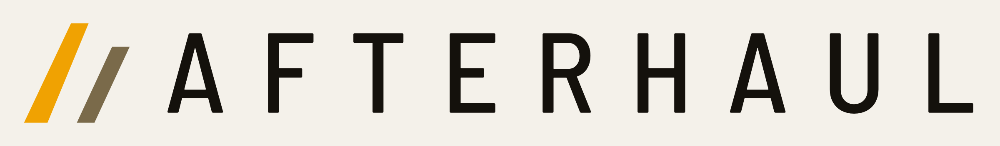

<p align="center">
  <picture>
    <source media="(prefers-color-scheme: dark)" srcset="assets/img/brand/afterhaul-logo-on-dark.png">
    
  </picture>
</p>

<h1 align="center">AFTERHAUL website</h1>

<p align="center">
  <strong>The public website of AFTERHAUL, a co-op offroad trucking game for up to eight players.</strong><br>
  Static HTML, CSS and JavaScript · Deployed with GitHub Pages · By Hound Protocol
</p>

<p align="center">
  <a href="https://hound-protocol.github.io/afterhaul-web/">Live site</a> ·
  <a href="https://hound-protocol.github.io/afterhaul-web/#roadmap">Roadmap</a> ·
  <a href="https://hound-protocol.github.io/afterhaul-web/#log">Changelog</a> ·
  <a href="CHANGELOG.md">Site versions</a>
</p>

<p align="center">
  <a href="https://github.com/Hound-Protocol/afterhaul-web/actions/workflows/pages.yml"></a>
  
  
  
</p>

---

## About
This repository holds the website of **AFTERHAUL**. The game itself lives in a separate, private repository. The site is the public face of the project: the pitch, the atmosphere, the player guide, the roadmap and the changelogs.

> **Status: unlisted.** The repository is public and the site deploys on every push to `main`, but the pages carry `noindex` and `robots.txt` disallows crawling, so search engines skip it until launch. The game is at the **Concept** stage and nothing is playable.

## Site Contents
| Section | What it holds |
|---|---|
| **About** | The game, driver classes, the world, design choices (sound, visual) and the release stages |
| **Wiki** | The player guide, in folders, with search and a reader. Built from the game's player documents |
| **Roadmap** | Release stages and plans, with four statuses: Complete, In Progress, Planned, Abandoned |
| **Changelog** | Website and game changelogs, with a patch type for every version |
| **Community** | Where players will meet (links open as they become ready) |
| **Press** | Contact, and the logo kit |

## What stays off this site
Marketing-level content and the player guide only. **No** tuned numbers, system specifications or the design document. The player guide is written in plain words (decisions 0003 and 0018 in the game repository).

## Files
| Path | What |
|---|---|
| `index.html` | The page. The Wiki, Changelog and Roadmap blocks are generated (see below) |
| `404.html`, `robots.txt` | Not-found page and crawler rules |
| `assets/css/afterhaul.css` | Styles |
| `assets/js/afterhaul.js` | Tabs, wiki reader, roadmap, road scene, update notice |
| `assets/img/brand/` | The logo set: wordmark (dark and light), mark and square, as SVG and PNG |
| `assets/fonts/` | Barlow Semi Condensed and Share Tech Mono (SIL Open Font License) |
| `content/` | Data the generators read: roadmap, patch types, game changelog, changelog times |
| `tools/` | Generators, the logo builder, the deploy optimizer and the scene editor |
| `CHANGELOG.md` | Website versions |
| `docs/` | Project notes |

## Preview
No build step is needed for the source. Run:
```
python3 -m http.server 8000
```
then open http://localhost:8000.

## Generated blocks
Three blocks in `index.html` are written by scripts. Edit the data, run the script, commit both.

| Block | Command | Reads |
|---|---|---|
| Wiki (player guide) | `python3 tools/build_docs.py <game repo>/docs/player` | The game repository's `docs/player/` (private) |
| Changelog | `python3 tools/build_changelog.py` | `CHANGELOG.md`, `content/game-changelog.md`, `content/patch-types.json`, `content/changelog-times.json` |
| Roadmap | `python3 tools/build_roadmap.py` | `content/roadmap.json` |

`python3 tools/make_logo.py` rebuilds the logo files.

## Versions
Pre-release versions are `0.x.y-pre`. A release changes four things together: the `?v=` on the CSS and JS links, `#siteVersion` in the footer, an entry at the top of `CHANGELOG.md`, and the version's patch type in `content/patch-types.json` (Overhaul, Feature, Content, Polish, Fix, Optimization, Tools, Brand or Foundation).

## Deploy
`.github/workflows/pages.yml` runs on every push to `main`. It builds an optimized copy (minified CSS and JS, lossless PNG recompression, WOFF2 fonts) with `tools/optimize.py`, and falls back to a plain copy if that fails. Source files are never changed.

Settings → Pages → Source must be **GitHub Actions** (once). At launch, remove `<meta name="robots" content="noindex">` from `index.html` and the `Disallow` line in `robots.txt`.

## Licence
Proprietary. Copyright (C) 2026 Hound Protocol. All rights reserved. See [LICENSE](LICENSE). Fonts are under the SIL Open Font License; see [THIRD_PARTY_NOTICES.md](THIRD_PARTY_NOTICES.md).
