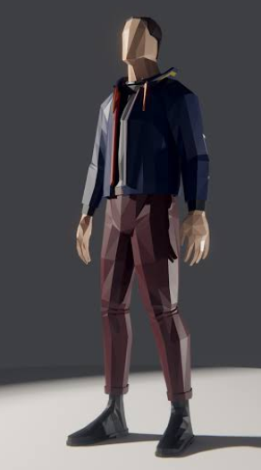
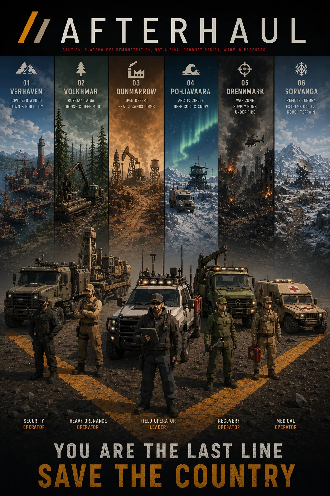

# Design choices
Before AFTERHAUL comes to fruition, our team was pondering over design choices that will define the personality of the game world.

## Sound design

Visceral, intense, loud and charismatic.

We want trucks to sound like raw machines with a punch to them. Treat the gas gently, and the truck will respond gently. Hit the gas at 100%, and the truck will respond in a full spectrum.

### In-cab sound design

Our vision of in-cab sound design and what we are aspiring to design in AFTERHAUL. 

### Drag racing sound

We predominantly source our inspiration of sound design from drag racing competitions. We try our best to implement it into the game with sound occlusion, distant sound processing, directional sound processing and more sound compression, to achieve visceral and authentic sound design.

Our primary mission is to achieve sound fidelity by design, as demonstrated in the video "Drag racing sound" (YouTube).

### Crash sound

In AFTERHAUL, crashing your truck is going to be a cinematic, intimidating and audio-rich experience. Our goal is to make every object its own sound source. We are developing a system that will allow the player to hear the entire chaos of their cabin in an orchestrated, natural format. We are learning how impacts, crashes and accidents sound, and how we can transform that intensity and atmosphere into AFTERHAUL accurately, as in the video "Crash sound" (YouTube).

### Artillery sound

In the war zone, artillery is something you hear before you see it: a distant shot, the whistle of the shell, then the impact. That sequence, and the dread it builds, is the sound we are aiming for. 

### First-person crash reactions

An impactful and reactive first-person view, combined with our active ragdoll system, will provide immersion and a tangible response from the in-cabin view. Our biggest inspiration came from how Need for Speed Shift 2 handles first-person player character impacts and accidents. (Video: "First-person crash reactions", on YouTube.)

The videos are other people's work, shown on the website as inspiration. The videos and their preview pictures come from YouTube.

## Visual design

AFTERHAUL is a low poly / high detail project. We aim for high performance and accessibility on even lower end setups. Our goal is to achieve low poly design, with physics, especially applied to our Active-Ragdoll system characters.

### Placeholder pictures

The character picture on the website is a placeholder (a low-poly man in a navy jacket and maroon trousers, standing). It is not actual in-game graphics.

The cover art on the website is temporary. It was made with generative AI (AIGC). It is a stand-in only: not the final art and not in-game graphics.

